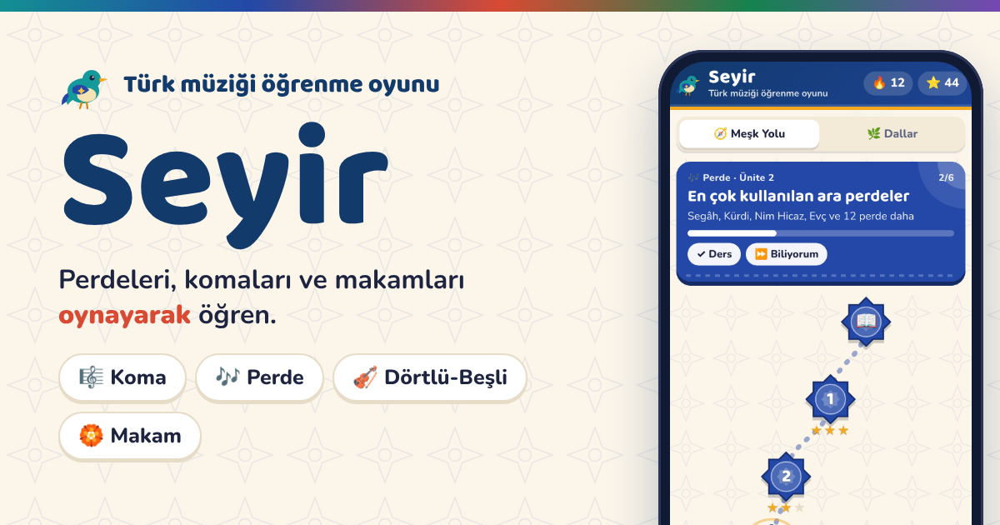
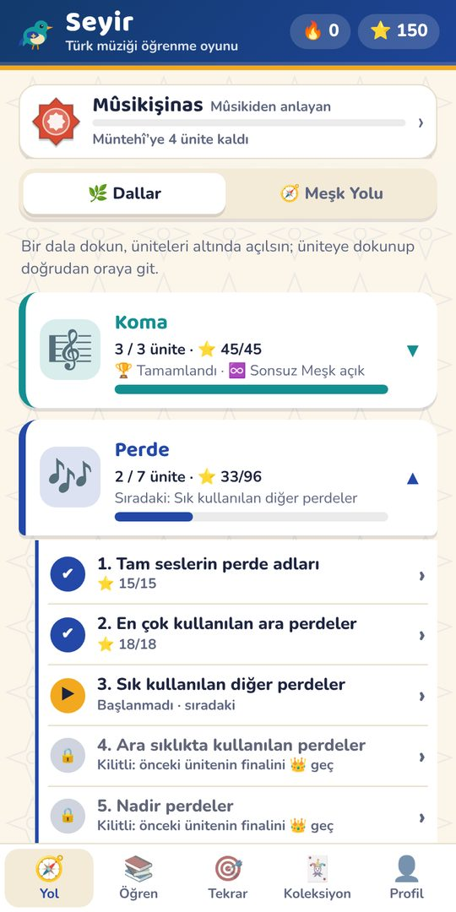
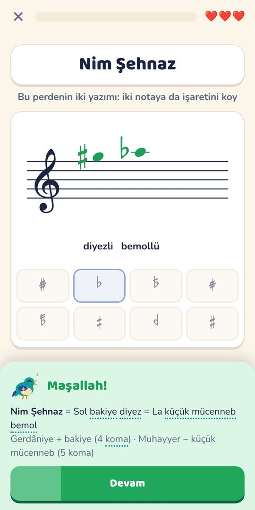
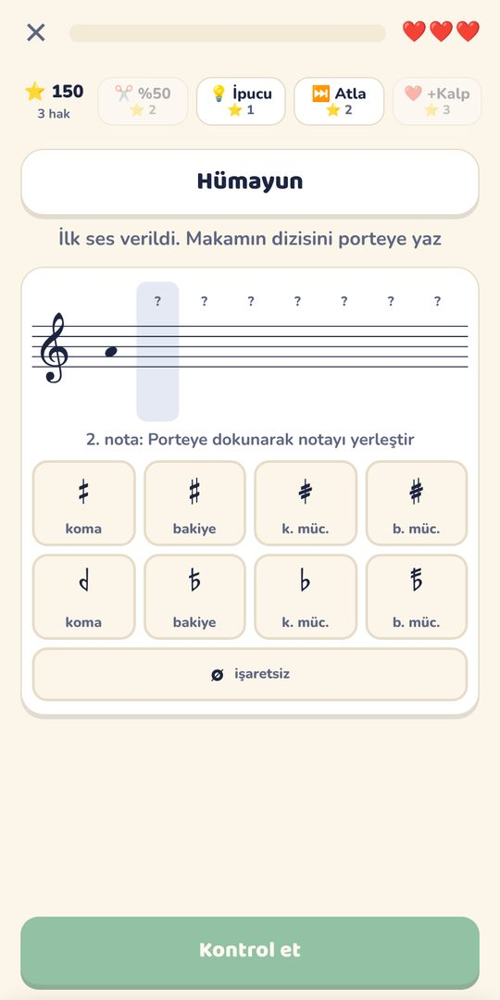
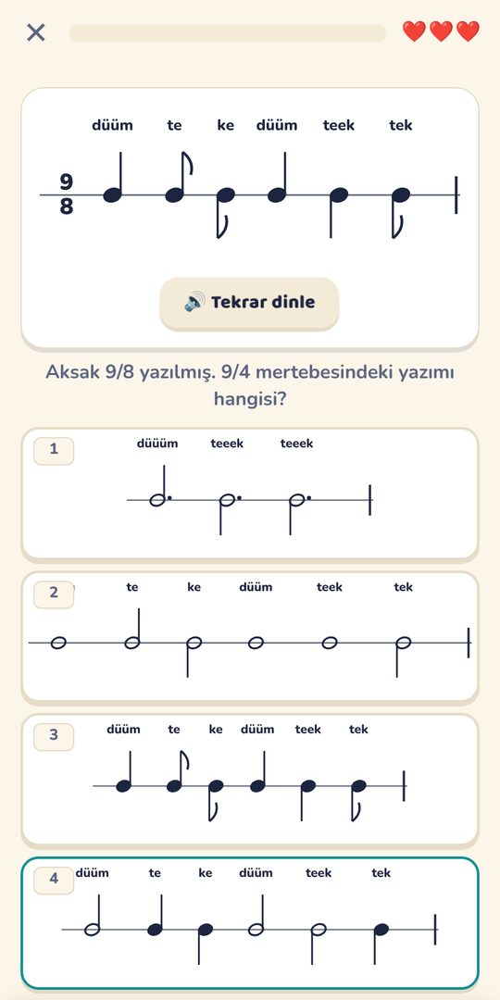
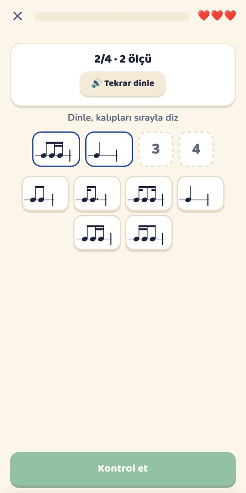
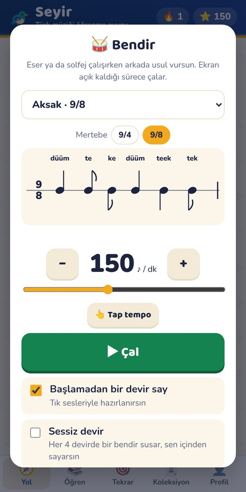

# Seyir · Türk müziği öğrenme oyunu

Türk müziği öğrencilerinin Arel-Ezgi-Uzdilek sistemindeki komaları, perdeleri, dörtlü-beşlileri, makamları, göçürmeyi, usulleri ve ahenkleri oyun oynayarak öğrenmesi için hazırlanmış bir web uygulaması. Batı müziği teorisi ve ritim diktesi için ayrı bir bölümü de var.

<a href="https://burakbastas.github.io/perde-oyunu/"><b>▶ Hemen oyna: burakbastas.github.io/perde-oyunu</b></a>

Ücretsizdir, üyelik istemez, reklam yoktur. Telefonda, tablette ve bilgisayarda çalışır; bir kez açıldıktan sonra internetsiz de oynanır.

## Neler var?

<table>
<tr>
<td align="center" width="33%"> <b>Dallar</b> Koma, Perde, Usul, Dörtlü-Beşli, Göçürme, Makam, Ahenk ve Batı Teorisi. Bir dala dokun, istediğin üniteden başla.</td>
<td align="center" width="33%"> <b>Perdeyi yaz</b> Perde adı verilir, işaretini sen koyarsın; iki yazımlı perdelerde hem diyezli hem bemollü yazımı.</td>
<td align="center" width="33%"> <b>Makamı kur</b> Dörtlü-beşlilerden makam dizilerine; diziyi porteye kendin yaz, göçürmeyi aralık aralık hesapla.</td>
</tr>
<tr>
<td align="center"> <b>Usul ve mertebe</b> 20 usul; dinle, hecelerini öğren, mertebesini bul ve usulü ekrana kendin vur.</td>
<td align="center"> <b>Ritim diktesi</b> Temel tartımlardan üçlemeye, 6/8’e ve aksak ölçülere: duyduğunu yaz, gördüğünü vur.</td>
<td align="center"> <b>Bendir</b> Eser ya da solfej çalışırken istediğin usulü, istediğin mertebe ve hızda çalar.</td>
</tr>
</table>

Bunlara ek olarak: kısa dersler, yanlış yapılanları geri getiren **aralıklı tekrar**, doğru bildikçe zorlaşan **♾️ Sonsuz Meşk**, Mübtedî’den Hâce’ye **meşk ünvanları** ve telefon için indirilebilir **duvar kâğıtları** (koma tablosu, perdeler).

## Telefona uygulama gibi ekleme

- **iPhone:** Safari’de aç → Paylaş → **Ana Ekrana Ekle**
- **Android:** Chrome’da aç → ⋮ → **Uygulamayı yükle**
- **Bilgisayar:** adres çubuğundaki yükle simgesi

Geliştiren: **Burak Baştaş** · Ondokuz Mayıs Üniversitesi, Türk Sanat Müziği Bölümü. Görüş ve önerileriniz için uygulamadaki 💬 düğmesini kullanabilirsiniz.

## Ses kaynakları

Bendir vuruşları, Freesound'daki “aksaksemai_bendir” kaydından (#140548, barisbozkurt) kesilmiştir. Çalan: Eren Ergen. Kayıt, CompMusic projesi (Universitat Pompeu Fabra, http://compmusic.upf.edu/) kapsamında yapılmıştır. https://freesound.org/people/barisbozkurt/sounds/140548/
